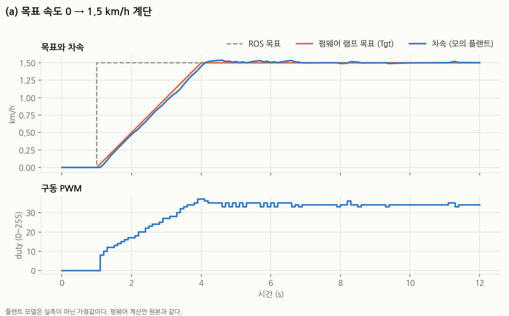
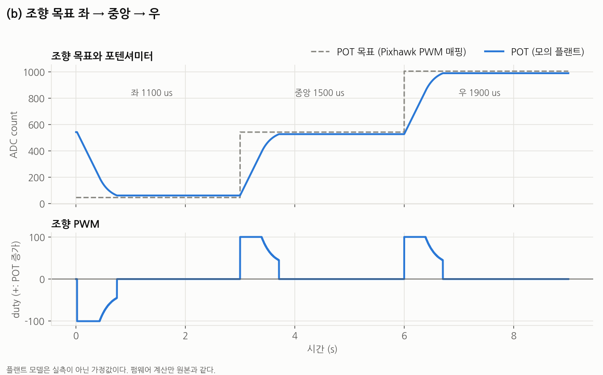
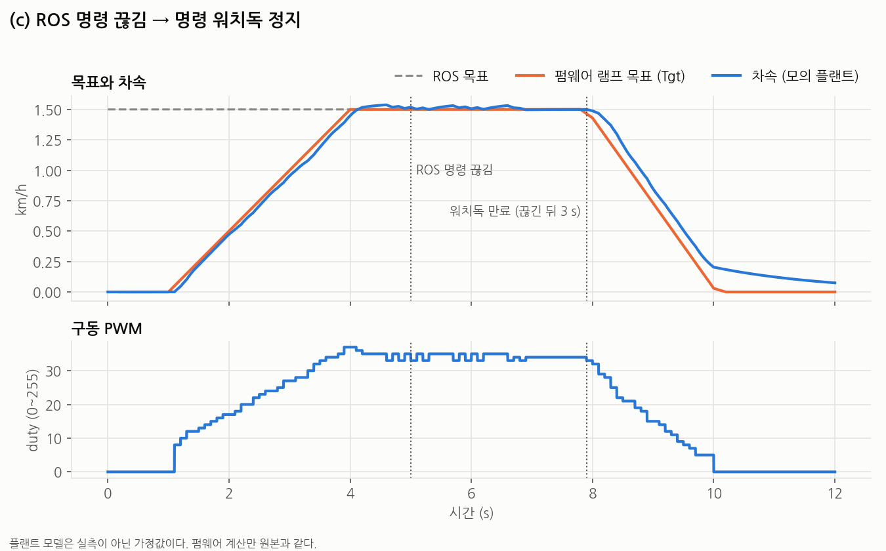

# SIL 시뮬레이션: t870_drive_layered

> **플랜트 모델은 실측이 아닌 가정값이다.** 차량 반응(속도 시정수, 조향 속도, 정지마찰 등)은 그래프를 그리려고 정한 값이다. 그래서 그래프의 모양은 실차와 다르다.
> 이 시뮬레이션이 보여 주는 것은 두 가지다. 하나는 펌웨어의 판단과 제어 계산이 의도대로 도는지이고, 다른 하나는 [`t870_drive_layered`](../t870_drive_layered)가 원본 [`sketch_aug.ino`](../../../sketch_aug/sketch_aug.ino)와 같은 출력을 내는지다.

## 구성

```
                ┌──────────────── sim_core ────────────────┐
                │ 가상 시간 (loop 1회 = 1 ms) · 모의 플랜트 │
                │ 가상 RC 보조 보드(I2C) · Pixhawk 펄스 · 시리얼 │
                └───────────────┬───────────┬──────────────┘
                                │           │
       sil_layered              │           │            sil_original
  ┌─────────────────────────────┴──┐   ┌────┴───────────────────────────────┐
  │ Mcal_Sim.cpp  (Mcal_*.cpp 대체) │   │ shim/ 가짜 Arduino.h · Wire.h        │
  │ Cdd · Bsw · Rte · Swc · .ino   │   │ sketch_aug.ino  (한 글자도 안 바꿈)   │
  │ (t870_drive_layered 그대로)    │   │                                    │
  └────────────────────────────────┘   └────────────────────────────────────┘
```

- **sil_layered**: 실기판용 `Mcal_*.cpp` 일곱 개를 `Mcal_Sim.cpp` 하나로 바꿨다. `Mcal_*.h` 헤더와 그 위의 Cdd · Bsw · Rte · Swc · `.ino`는 [`t870_drive_layered`](../t870_drive_layered)의 파일을 그대로 컴파일한다. "칩이 바뀌면 Mcal만"을 PC라는 칩으로 실제로 해 본 셈이다.
- **sil_original**: 원본 스케치를 고치지 않고 빌드하려고, 원본이 쓰는 Arduino API와 AVR 레지스터만 흉내 낸 `shim/`을 붙였다.
- 두 빌드는 같은 `sim_core`, 같은 시나리오를 쓴다. 한 loop 안에서는 `millis()`가 변하지 않는다. 그래서 두 펌웨어가 `millis()`를 몇 번 부르든 같은 시각을 본다.

### 모의 플랜트 (`sim_core.cpp`, 전부 가정값)

| 대상 | 모델 |
| :--- | :--- |
| 구동 | duty → 정상상태 속도 `0.050 km/h × (duty − 4)`, 시정수 0.4 s의 1차 지연. PWM 0이면 시정수 2.0 s로 관성 감속. DIR LOW는 후진 |
| 경사 | `9.81 × 경사 × 3.6` km/h/s로 뒤로 민다 (혼합 시나리오의 미션 홀드 구간만 10%) |
| 엔코더 | 이동 거리를 펌웨어와 같은 149.8 count/rev, 바퀴 지름 0.27 m로 환산해 A상 엣지를 낸다 |
| 조향 | duty가 정지마찰 30을 넘으면 `12 × (duty − 30)` count/s로 POT가 움직인다. 기계적 끝은 32 ~ 1020 |

플랜트는 펌웨어의 피드포워드(`duty = 6.4 + 17.9 × km/h`)와 일부러 조금 다르게 반응하게 잡았다. 그래야 PI가 오차를 메우는 모습이 그래프에 드러난다.

## 실행

필요한 것: `g++`(C++17), `make`, Python 3 + `matplotlib`, `pytest`. 그래프의 한글 라벨에는 나눔고딕 글꼴을 쓴다.

```bash
cd study/autosar_style/sil
make            # build/sil_layered, build/sil_original 빌드
make run        # 시나리오 (a)(b)(c)를 계층 버전으로 실행 -> out/*.csv, out/*.serial.txt
make plot       # out/*.csv -> images/*.png
make test       # 원본과 계층 버전 동등성 테스트 (pytest)
```

실행 파일을 직접 부를 수도 있다.

```bash
./build/sil_layered  speed_step out/a.csv out/a.serial.txt
./build/sil_original speed_step out/a_orig.csv out/a_orig.serial.txt
```

CSV는 1 ms마다 한 줄이다. 열은 `t_ms, ros_alive, ros_target_kmh, remote_mode, speed_kmh, drive_pwm, drive_dir, pixhawk_us, steer_target_ref, pot, steer_pwm, steer_dir`이다. `.serial.txt`는 펌웨어가 시리얼로 낸 전체 출력이다.

## 시나리오와 결과

| 시나리오 | 입력 |
| :--- | :--- |
| `speed_step` | AUTO. ROS 브리지처럼 100 ms마다 목표를 보내고, 1 s에 0 → 1.5 km/h |
| `steering` | AUTO. Pixhawk 조향 PWM 1100(좌) → 3 s에 1500(중앙) → 6 s에 1900(우) |
| `watchdog` | AUTO. 1.5 km/h 목표를 보내다 5 s에 ROS 명령이 끊긴다 |
| `mixed` | 동등성 테스트 전용. 아래 참고 |

### (a) 목표 속도 0 → 1.5 km/h 계단



- ROS 목표는 계단이지만, 펌웨어 목표(Tgt)는 가속 램프 0.5 km/h/s를 따라 약 3 s에 걸쳐 1.5에 닿는다.
- 차속은 램프를 조금 늦게 따라간다. duty 34 근처에서 1.5 km/h를 유지한다. 피드포워드만 쓰면 33이므로, 모의 플랜트와의 차이를 적분이 메운 것이다.
- duty가 계단 모양인 것은 정수 PWM과 100 ms 제어 주기 때문이다.

### (b) 조향 목표 좌 → 중앙 → 우



- 목표와의 거리가 150 count 이상이면 최대 duty 100으로 돌고, 가까워지면 duty를 비례로 줄인다.
- 불감대 15 count 안에 들면 PWM을 끈다. 그래서 POT는 목표에서 약 15 count 앞에서 멈춘다. 펌웨어의 `STEER_DEADBAND`가 그대로 보이는 것이다.
- 좌측 목표는 기계적 끝(32)이 아니라 소프트 리밋 47이다.

### (c) ROS 명령 끊김 → 명령 워치독 정지



- 마지막 명령(4.9 s)으로부터 3 s가 지난 7.9 s에 워치독이 시리얼 목표를 0으로 만든다.
- 펌웨어 목표는 감속 램프 0.7 km/h/s로 줄고, 10 s 부근에서 PWM이 0이 된다. 그 뒤 차속이 천천히 줄어드는 것은 브레이크가 없는 차의 관성주행을 모의 플랜트가 흉내 낸 것이다.
- 워치독은 즉시 정지가 아니라 감속 정지다. 원본 펌웨어 동작 그대로다. 즉시 차단은 `e` 명령과 수신기 단절이 맡는다.

## 동등성 테스트 (`test_equivalence.py`)

두 실행 파일을 같은 시나리오로 돌려 다음 두 파일을 **바이트 단위로** 비교한다.

- 1 ms마다 기록한 CSV: 구동 · 조향 PWM과 DIR, 모의 차속, POT
- 시리얼 출력 전체: 명령 응답, 200 ms 상태 줄

닫힌 루프라서 한 주기라도 계산이 다르면 그 뒤 기록 전체가 갈라진다.

`mixed` 시나리오(32 s)는 다음을 한 번씩 거친다.

- AUTO 순항 중 조향 목표 변경
- AUTO 반대 명령 능동 제동(duty 65) 뒤 후진
- 10% 경사에서 미션 홀드 `h`, 홀드 중 Pixhawk 단절
- 비상정지 `e`, 구동 개루프 `p40`, 조향 개루프 `s60` / `s-60` / `s0`
- 워치독 토글 `b`, 알 수 없는 명령, 래치 해제 `r`
- MANUAL 진입 시 스로틀 중립 대기, MANUAL 반대 스로틀 능동 제동
- 수신기 단절, 보조 보드 무응답, 복귀 후 중립 재확인
- 2.4 km/h 주행 중 미션 홀드(90을 넘는 끊어 거는 제동 구간)

테스트가 차이를 정말 잡아내는지도 함께 확인한다. 계층 버전의 상수 하나를 살짝 바꾼 사본 세 개를 빌드해, 각각 원본과 출력이 달라지는지 본다.

| 바꾼 상수 | 파일 |
| :--- | :--- |
| `HOLD_GAIN` 50.0 → 50.5 | `Swc_StopHold.cpp` |
| `AUTO_KI` 5.0 → 5.1 | `Swc_SpeedControl.cpp` |
| `STEER_DEADBAND` 15 → 16 | `Swc_SteeringControl.cpp` |

현재 결과는 다음과 같다.

```
$ make test
.......                                                                  [100%]
7 passed
```

시나리오 4개는 모두 원본과 같고, 바꾼 사본 3개는 모두 다르게 잡힌다.

## CAN 버전: sil_can

[`t870_drive_can`](../t870_drive_can)은 같은 코어와 시나리오로 돌되, 명령이 시리얼 대신 CAN으로 온다. RC · Pixhawk · 경사 입력과 CSV 형식은 다른 빌드와 같다. `SIL_CAN` 매크로로 `sim_main.cpp`에 버스 처리가 붙고, `Mcal_Can_Sim.cpp`가 실기판용 `Mcal_Can_Mcp2515.cpp`를 대신한다.

| 버스 | 시간 | 프레임 |
| :--- | :--- | :--- |
| `--bus=mem --frames=<파일>` | 가상 시간. 결과가 매번 같다 | 인메모리. `can_cmd_sender.py --dump`가 만든 목록을 해당 ms에 넣는다 |
| `--bus=vcan0` | 실시간 (`CLOCK_MONOTONIC`). 첫 프레임을 받으면 시작 | 실제 SocketCAN. `can_cmd_sender.py --bus vcan0`와 주고받는다 |

```bash
make can           # build/sil_can, build/com_roundtrip
make test-can      # test_can.py (python-can, cantools, numpy 필요)
make plot-can      # images/can_fault_crc.png, images/can_fault_timeout.png

# 직접 실행
T=../t870_drive_can/tools
python3 $T/can_cmd_sender.py $T/scenarios/mixed.txt --dump /tmp/mixed.frames
build/sil_can mixed /tmp/a.csv /tmp/a.txt --bus=mem --frames=/tmp/mixed.frames --tx-log=/tmp/tx.txt

build/sil_can speed_step /tmp/b.csv /tmp/b.txt --bus=vcan0 &
python3 $T/can_cmd_sender.py $T/scenarios/speed_step.txt --bus vcan0 --record /tmp/status.csv
```

결과와 허용 오차는 [`t870_drive_can/README.md`](../t870_drive_can/README.md#테스트)에 있다. `make test`와 `make all`에는 넣지 않았다. python-can과 cantools가 필요해서 CI에서도 `sil-can` 작업으로 따로 돌린다.

## 이 시뮬레이션이 보장하지 않는 것

- **실차 응답**: 플랜트가 가정값이므로 그래프의 시간 · 오버슈트 · duty 수치는 실차와 다르다.
- **AVR 부동소수 결과**: PC에서는 `double`이 64비트이고 `1000.0` 같은 리터럴도 64비트로 계산한다. AVR에서는 둘 다 32비트다. 동등성은 "같은 PC 컴파일러에서 원본과 계층 버전이 같다"는 뜻이지, AVR에서 나올 숫자와 같다는 뜻이 아니다.
- **Mcal 자체**: SIL에서는 `Mcal_*.cpp`를 `Mcal_Sim.cpp`로 바꿔 끼우므로 실기판용 Mcal 코드는 실행되지 않는다. 실기판용 Mcal이 원본 레지스터 코드와 같은지는 코드 대조로만 확인했다.
- **타이밍과 인터럽트 경합**: 실제 loop는 1 ms보다 훨씬 빠르다. 엔코더 · Pixhawk 인터럽트는 loop와 loop 사이에만 들어온다. loop 도중에 끼어드는 인터럽트나 실행 시간 차이로 생기는 문제는 재현하지 않는다.
- **통신 오류**: I2C 보고서는 항상 온전히 오고, 시리얼은 글자가 빠지지 않는다. 깨진 프레임 처리는 CAN 경로(`test_can.py`)에서만 시험한다. 그것도 송신기가 일부러 낸 고장이고, vcan에는 실제 버스의 비트 오류나 중재가 없다.
