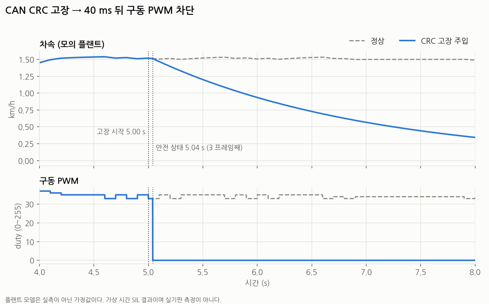
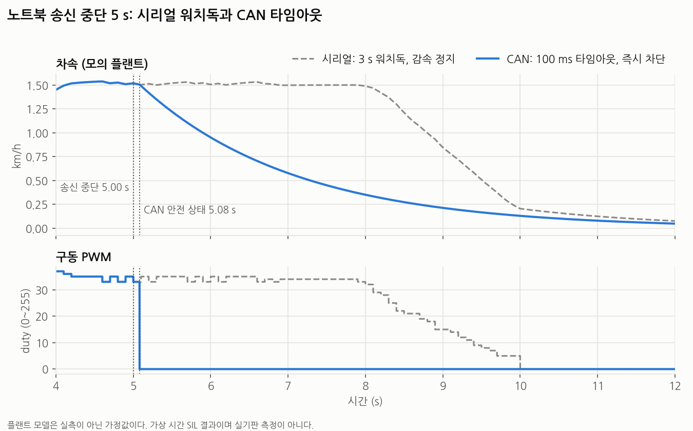

# t870_drive_can

> **실차와 실기판에 올리지 않은 학습용 구조 연습이다.** 검증은 PC SIL과 리눅스 가상 CAN(`vcan0`)까지다. MCP2515용 `Mcal_Can_Mcp2515.cpp`는 Uno 대상으로 컴파일만 확인했고 실행한 적이 없다.
> 실제 차량에서 돈 펌웨어는 [`sketch_aug/sketch_aug.ino`](../../../sketch_aug/sketch_aug.ino)다. 이 폴더는 [`t870_drive_layered`](../t870_drive_layered)를 복사해 "노트북 → Arduino" 명령 경로만 시리얼 텍스트에서 CAN으로 바꾼 것이다.

## 계층

```
노트북  tools/can_cmd_sender.py (python-can)
   │  0x100 DriveCmd 20 ms          ▲ 0x200 DriveStatus 100 ms, 0x201 DriveDiag 500 ms
───┼────────────── CAN 500 kbit/s ──┼──────────────────────────────────────────
   ▼                                │
Mcal_Can                Mcal_Can_Mcp2515.cpp (실기판) / ../sil/Mcal_Can_Sim.cpp (PC)
   │
CanIf                   수신 ID 필터, 송신 큐 4 프레임
   │
Com ── E2E              pack/unpack(Com_Cfg.h), 주기 송신, 수신 타임아웃
   │                    E2E: CRC8 + Alive -> OK / WRONG_CRC / REPEATED / WRONG_SEQ / NO_NEW_DATA
Cdd_CanGateway          DriveCmd(현재 상태)를 명령 사건으로 변환, Rte -> DriveStatus
   │
Rte                     Rte_Notify_SerialCommand, Rte_Notify_ComSafeState
   │
Swc_SpeedControl · Swc_SteeringControl · Swc_StopHold     (layered 와 바이트 단위로 같다)
```

시리얼은 디버그 출력(상태 줄, 명령 응답)만 남았다. `Cdd_SerialCmd`는 빠졌다.

## layered에서 바뀐 것

| 파일 | 변경 |
| :--- | :--- |
| `Swc_*` | **없음.** `test_can.py`가 layered와 바이트 비교한다 |
| 새 파일 | `Mcal_Can.h`, `Mcal_Can_Mcp2515.cpp`, `CanIf`, `Com`, `E2E`, `Cdd_CanGateway`, 생성 파일 `Com_Cfg.h` |
| `Cdd_SerialCmd.*` | 삭제 |
| `Mcal_Cfg.h` | 구동 DIR을 D11 → D4, MCP2515 CS · INT, 크리스털 |
| `Rte.h/.cpp` | `Rte_Read_SteerPwm`, `Rte_Read_Watchdog_Expired`, `Rte_Read_FaultLatch_E2e`, `Rte_Notify_ComSafeState` 추가 |
| `Bsw_FaultLatch` | E2E 래치 추가. `ClearAll`이 함께 지운다 |
| `Bsw_Watchdog` | 만료 상태 읽기 추가 (DriveStatus의 `FaultWatchdog`) |
| `Cdd_Telemetry` | 배너 문구, 상태 줄 끝 ` \| E2E-FAULT` |
| `.ino` | 수신 · 송신 호출, 초기화 순서 |

`Rte_SerialCmdType`, `Rte_Read_SerialSpeedCmdKmh` 같은 이름에 "Serial"이 남아 있다. Swc가 이 이름을 쓰므로 Swc를 고치지 않으려고 그대로 뒀다.

### 왜 `Rte_Write`가 아니라 `Rte_Notify_SerialCommand`인가

`Rte_Write_SerialSpeedCmdKmh()`로 값만 넣으면 `Swc_SpeedControl_OnTargetSpeedCmd()`가 하는 최고 속도 제한, 미션 홀드 해제, 개루프 해제, 목표 변경 시 적분 리셋이 빠진다. 적분값은 Swc 내부 변수라 밖에서 건드릴 수 없다. 그래서 시리얼과 같은 이벤트 포트로 넘긴다.

## DBC ([`can/t870.dbc`](can/t870.dbc))

전부 리틀엔디언 8 바이트 프레임이다. 바이트 7은 CRC8이다. `Com_Cfg.h`는 `python3 can/gen_com_cfg.py`로 DBC에서 생성하고, `--check`와 테스트가 둘이 같은지 확인한다.

### 0x100 DriveCmd (노트북 → ECU, 20 ms, DataID 0x10)

| 신호 | 비트 | 형식 | 값 |
| :--- | --: | :--- | :--- |
| `TargetSpeed_kmh` | 0 \| 16 | int16, 0.01 km/h/bit | ±327.67. 실제 제한은 Swc의 ±10 km/h |
| `SteerTargetPot` | 16 \| 16 | uint16 | 0~1023. **전달만 하고 조향 제어에 연결하지 않았다** (아래) |
| `Mode` | 32 \| 2 | enum | 0 MANUAL, 1 AUTO, 2 HOLD, 3 ESTOP |
| `OpenLoopSel` | 34 \| 2 | enum | 0 NONE, 1 DRIVE, 2 STEER |
| `Alive` | 36 \| 4 | uint4 | 프레임마다 +1 |
| `OpenLoopDuty` | 40 \| 10 | int10 | −255~255 |
| `WatchdogDisable` | 50 \| 1 | bool | 3 s 워치독 끄기. E2E 감시는 끄지 못한다 |
| `LatchClearReq` | 51 \| 1 | bool | 상승 에지에서 래치 해제 |
| `CRC8` | 56 \| 8 | uint8 | SAE J1850, 바이트 0~6 + DataID |

### 0x200 DriveStatus (ECU → 노트북, 100 ms, DataID 0x20)

| 신호 | 비트 | 형식 |
| :--- | --: | :--- |
| `MeasuredSpeed_kmh` | 0 \| 16 | int16, 0.01 km/h/bit |
| `SteerPot` | 16 \| 16 | uint16 |
| `DrivePwm`, `SteerPwm` | 32 \| 8, 40 \| 8 | uint8 duty |
| `FaultSteer`, `FaultStall`, `FaultWatchdog`, `FaultE2E` | 48, 49, 50, 51 | bool |
| `Alive`, `CRC8` | 52 \| 4, 56 \| 8 | |

### 0x201 DriveDiag (ECU → 노트북, 500 ms, DataID 0x21)

`CrcErrorCount`(16), `AliveJumpCount`(16), `AliveRepeatCount`(8), `TimeoutCount`(8), `E2EState`(3), `Alive`, `CRC8`. 카운터는 끝에서 멈춘다.

## 시리얼 명령과의 대응

시리얼 명령은 한 번 오는 사건이고 DriveCmd는 20 ms마다 오는 현재 상태다. 매 프레임 그대로 넘기면 `b`는 20 ms마다 토글되고 상태 메시지가 쏟아진다. `Cdd_CanGateway`가 바뀔 때만 사건으로 바꾼다.

| 시리얼 | DriveCmd | 게이트웨이 |
| :--- | :--- | :--- |
| `<km/h>` | `Mode=AUTO`, `TargetSpeed_kmh` | 값이나 모드가 바뀔 때 |
| `e` | `Mode=ESTOP` | ESTOP이 되는 순간 |
| `h` | `Mode=HOLD` | 매 프레임. Swc가 500 ms 안에 갱신을 요구한다 |
| `p<duty>` | `OpenLoopSel=DRIVE`, `OpenLoopDuty` | 값이 바뀔 때. AUTO에서만 |
| `s<duty>` | `OpenLoopSel=STEER`, `OpenLoopDuty` | 값이 바뀔 때. 다른 선택이 되면 duty 0 |
| `b` | `WatchdogDisable` | 현재 상태와 다를 때만 토글 |
| `r` | `LatchClearReq` | 상승 에지 |

제약이 두 가지 있다. duty 신호가 하나라 구동 개루프와 조향 개루프를 동시에 걸 수 없다. 시리얼의 "알 수 없는 명령" 응답은 없어졌다.

**RC 스위치가 여전히 AUTO/MANUAL을 정한다.** `Mode=MANUAL`은 "노트북이 AUTO 명령을 내지 않는다"는 뜻으로 목표 0처럼 처리하고, 물리 스위치를 덮어쓰지 않는다.

**`SteerTargetPot`은 조향에 연결하지 않았다.** AUTO 조향 목표는 `Swc_SteeringControl`이 Pixhawk PWM(D8)에서 직접 계산한다. 시리얼 경로에도 조향 목표 명령은 없었다. CAN 목표를 쓰려면 Swc를 고쳐야 하므로 신호 자리만 잡아 뒀다.

## E2E와 안전 상태

수신 프레임마다 CRC를 먼저 본 뒤, 믿을 수 있는 프레임의 Alive만 본다. 통과하지 못한 프레임의 신호는 위로 올라가지 않는다.

| 상태 | 조건 | 카운터 |
| :--- | :--- | :--- |
| `OK` | CRC 일치, Alive 차이 1 | |
| `WRONG_CRC` | CRC 불일치 또는 DLC ≠ 8 | `CrcErrorCount` |
| `REPEATED` | Alive 차이 0 | `AliveRepeatCount` |
| `WRONG_SEQ` | Alive 차이가 허용보다 큼. 기준값을 새로 잡는다 | `AliveJumpCount` |
| `NO_NEW_DATA` | 정상 프레임이 100 ms 넘게 없음 | `TimeoutCount` |

- **안전 상태 요청**: 실패 연속 3 프레임(`E2E_FAIL_THRESHOLD`) 또는 타임아웃 100 ms(`E2E_RX_TIMEOUT_MS`, `Com.h`).
- **CRC로 버린 프레임은 Alive 허용 폭을 그만큼 늘린다.** 안 그러면 프레임 하나가 깨졌을 때 다음 정상 프레임까지 `WRONG_SEQ`가 되어 고장을 두 번 센다.
- **첫 정상 프레임 전에는 타임아웃을 세지 않는다.** 명령이 온 적 없으면 차가 움직이지 않고, 켤 때마다 해제를 요구하면 불편하기만 하다. 기존 3 s 워치독은 그대로 돈다.
- **처리(`Rte_Notify_ComSafeState`)**: 기존 워치독 처리에 비상정지를 더한다. 워치독 처리만으로는 감속 정지라 PWM이 바로 안 끊기고, 비상정지만으로는 조향 개루프가 안 꺼져서 둘 다 부른다. E2E 래치도 세운다.
- **물리 RC MANUAL이면 구동 출력을 건드리지 않는다.** 기존 `OnEmergencyStopCmd`의 조건 그대로다. RC 주행은 노트북과 무관하게 유지된다.
- **AUTO 조향은 계속 Pixhawk를 따른다.** 안전 상태가 끄는 것은 구동 출력과 개루프다.
- **자동 복귀하지 않는다.** 통신이 돌아와도 정지를 유지한다. 해제는 정상 프레임의 `LatchClearReq` 상승 에지이고, 그 프레임의 목표가 0이고 개루프가 꺼져 있어야 한다. 옛 목표로 저절로 출발하지 않게 하려는 것이다.

## 핀 배치 (Arduino Uno)

MCP2515의 SPI가 D11~D13을 쓰므로 D11의 구동 DIR을 옮겼다. D12는 `sketch_aug`에 "모드 스위치(미구현)" 주석만 있고 코드에서 쓰지 않아 충돌이 없다.

| Uno 핀 | layered | 이 버전 |
| :--- | :--- | :--- |
| D2, D3 | 엔코더 A, B | 그대로 |
| **D4** | | **구동 DIR (D11에서 옮김)** |
| **D5** | | **MCP2515 INT** |
| **D6** | | **MCP2515 CS** |
| D7 | 조향 DIR | 그대로 |
| D8 | Pixhawk PWM | 그대로 |
| D9 | 조향 PWM | 그대로 |
| D10 | 구동 PWM | 그대로 (하드웨어 SS 핀, 아래 주의) |
| **D11** | 구동 DIR | **MCP2515 SI (MOSI)** |
| **D12** | | **MCP2515 SO (MISO)** |
| **D13** | | **MCP2515 SCK** |
| A0 | 조향 POT | 그대로 |
| A4, A5 | I2C (보조 RC 보드) | 그대로 |

INT는 폴링으로 읽는다. 외부 인터럽트 D2/D3은 엔코더가 쓰고, 20 ms 주기 프레임은 폴링으로 충분하다.

**D10 주의.** 라이브러리의 `MCP2515` 생성자는 `SPI.begin()`을 부르고, `SPI.begin()`은 SS(D10)가 아직 입력이면 HIGH를 쓴 뒤 출력으로 바꾼다. 객체를 전역으로 두면 `setup()` 전에 구동 PWM 핀이 HIGH가 되어 **구동 모터가 duty 100%를 받는다.** 그래서 `Mcal_Can_Init()` 안의 지역 static으로 두고 `Mcal_Port_Init()` 다음에 부른다. 테스트가 이 순서를 확인한다. 라이브러리 소스를 읽어 확인한 내용이고 실기판에서 측정하지는 않았다.

**D11 주의.** 배선을 옮기지 않으면 SPI 통신 때마다 구동 방향 신호가 흔들린다.

## 빌드 결과

`arduino-cli compile -b arduino:avr:uno --warnings all` (arduino:avr 1.8.8, autowp-mcp2515 1.3.1), 경고 없음.

| | 플래시 | RAM (전역) | 남은 RAM |
| :--- | --: | --: | --: |
| 원본 `sketch_aug` | 13,822 B (42%) | 1,062 B (51%) | 986 B |
| `t870_drive_layered` | 13,978 B (43%) | 1,061 B (51%) | 987 B |
| `t870_drive_can` | 17,516 B (54%) | 1,175 B (57%) | 873 B |
| layered 대비 | +3,538 B | +114 B | −114 B |

라이브러리 설치: `arduino-cli lib install "autowp-mcp2515@1.3.1"`

## 테스트

```bash
cd ../sil
make test-can      # test_can.py. vcan0 이 없으면 vcan 테스트만 건너뛴다
make test          # 기존 원본 vs layered
make plot-can      # images/can_fault_*.png
```

vcan0 올리기: `sudo modprobe vcan && sudo ip link add dev vcan0 type vcan && sudo ip link set up vcan0`

### 동등성: 시리얼 layered vs CAN can

| 버스 | 비교 | 허용 오차 |
| :--- | :--- | :--- |
| `--bus=mem` (가상 시간) | `speed_step`, `steering`, `mixed`의 1 ms CSV 전체와 `RC:` 상태 줄 | **0.** 바이트 단위로 같다 |
| `vcan0` (실시간) | 위 시나리오의 `drive_pwm`, `steer_pwm` | 시간축 ±150 ms 안의 layered 값 범위 + 아래 duty |

실시간 허용 오차의 근거는 다음과 같다.

- **±150 ms**: 제어 태스크 100 ms + 프레임 주기 20 ms + 지터 30 ms.
- **홀드 구간 밖 ±2 duty**, **홀드 구간(mixed의 9~12 s, 29~32 s) 안 ±45 duty.**
- 프레임이 100 ms 제어 태스크보다 1 ms만 늦어도 명령이 다음 주기로 밀린다. 미션 홀드의 밀림 제어는 플랜트와 맞물린 리밋 사이클이라 이 차이가 위상 차이로 남는다. 앞선 명령의 지연도 플랜트 상태를 거쳐 뒤의 홀드까지 간다.
- `test_arrival_delay_differs_only_in_hold_windows`가 지터 없는 가상 시간에서 도착만 1~2 ms 늦춰 같은 결과가 나는지 확인한다. 초과량 실측 최대는 38 duty다.
- 홀드 구간 밖 초과량은 실측 2 duty로, 허용치에 여유가 없다. 실시간 mixed를 10회 반복해 모두 통과했다.

`watchdog` 시나리오는 **일부러 다르다.** 시리얼은 3 s 뒤 감속 정지, CAN은 100 ms 타임아웃 뒤 즉시 차단이다.

### E2E 고장 주입

고장 프레임 시작부터 구동 PWM 0까지 걸린 시간이다. 시나리오는 1.5 km/h 주행 중 5 s에 고장 시작이다.

| 고장 | `--bus=mem` | `vcan0` 실측 | 기대값 |
| :--- | --: | --: | :--- |
| (a) CRC 깨짐 | 40 ms | 40 ms | 고장 프레임 3개째 |
| (b) Alive 정지 | 40 ms | 41 ms | 고장 프레임 3개째 |
| (c) Alive 점프 | 40 ms | 41 ms | 고장 프레임 3개째 |
| DLC 7 | 40 ms | 41 ms | 고장 프레임 3개째 |
| (d) 0x100 송신 중단 | 81 ms | 81~82 ms | 마지막 정상 프레임(−20 ms) + 101 ms |

- `FaultE2E` 비트는 안전 상태 뒤 다음 0x200(최대 100 ms)에 보인다. vcan 테스트 합격 기준은 위 기대값 + 40 ms, 비트는 여기에 100 ms를 더한 값이다.
- 임계값 아래의 고장(CRC 2 프레임, 점프 2 프레임, 정지 2 프레임)은 출력을 바꾸지 않는다. 1 ms CSV가 정상 실행과 바이트 단위로 같다.
- 기타 확인 항목: RC MANUAL 주행 유지, 부팅 후 프레임 없음, 조향 개루프 해제, 래치 해제 조건, 진단 카운터.
- 이 노트북에서 16코어 전부에 부하를 걸고 실시간 15 s를 돌렸을 때 송신 간격은 11.95~31.07 ms였고 E2E 오검출은 없었다.





### candump 예시

전체 발췌는 [`can/candump_crc_fault.log`](can/candump_crc_fault.log)에 있다. 5.000 s부터 0x100의 CRC를 깨서 보냈다.

```
(  4.980)  vcan0  100   [8]  96 00 1F 02 91 00 00 56
(  5.000)  vcan0  100   [8]  96 00 1F 02 A1 00 00 9C    <- 고장 시작
(  5.000)  vcan0  200   [8]  9C 00 1F 02 21 00 10 8E    <- DrivePwm 0x21, FaultE2E 0
(  5.020)  vcan0  100   [8]  96 00 1F 02 B1 00 00 B9
(  5.040)  vcan0  100   [8]  96 00 1F 02 C1 00 00 42    <- 3 프레임째, 안전 상태
(  5.100)  vcan0  200   [8]  95 00 1F 02 00 00 28 5F    <- DrivePwm 0, FaultE2E 1
```

## 실제 AUTOSAR와 다른 점

- **PduR이 없다.** CanIf가 Com을 직접 부른다. 게이트웨이나 다른 버스로의 라우팅이 없어서 필요 없었다.
- **Com 생성기가 없다.** 실제로는 ARXML에서 Com · CanIf · PduR 설정을 생성한다. 여기서는 작은 파이썬 스크립트가 DBC에서 헤더 하나를 만들고, 수신 ID와 주기 처리는 손으로 썼다. 신호 게이트웨이, 필터, 업데이트 비트, I-PDU 그룹도 없다.
- **E2E 프로파일을 단순화했다.** 표준 Profile 1과 CRC8 J1850, 4 비트 카운터는 비슷하지만 DataID 모드, `MaxDeltaCounter` 설정, E2E 상태 기계(`E2E_SM`)의 윈도우 판정이 없다. 연속 실패 3 프레임과 타임아웃만 본다. E2E 라이브러리를 Com 안에서 부르고 Transformer나 RTE 연동이 없다.
- **CanSM / CanNm / CanTp가 없다.** 버스 오프 관리, 네트워크 관리, 진단 전송이 없다. 버스 오프 복구는 MCP2515 하드웨어 동작에 맡겼다.
- **DEM이 없다.** 고장은 bool 래치와 카운터뿐이다. 영구 저장되지 않는다.
- **SWC가 신호를 직접 읽지 않는다.** 실제로는 Com 신호가 RTE 포트에 바로 매핑된다. 여기서는 Swc를 안 고치려고 `Cdd_CanGateway`가 상태를 사건으로 바꿔 기존 이벤트 포트로 넣는다. 시리얼 시절 이름도 남았다.
- **MCAL이 표준 Can 드라이버가 아니다.** `Can_Write` / `CanIf_RxIndication` 콜백 구조 대신 폴링 함수 세 개다. 외장 컨트롤러 라이브러리를 감쌌다. 하드웨어 수신 필터도 쓰지 않고 CanIf에서 거른다.

그 밖의 차이는 [`t870_drive_layered/README.md`](../t870_drive_layered/README.md)와 같다.

## 실차 이식 절차

아직 해 본 적이 없는 절차다. 라이브러리 소스와 데이터시트 기준으로 쓴 것이므로 단계마다 확인이 필요하다. **처음에는 바퀴를 띄우고 시험한다.**

### 1. 크리스털 확인

MCP2515 모듈의 크리스털 캔에 적힌 값을 읽고 `Mcal_Cfg.h`의 `MCAL_CAN_CRYSTAL_MHZ`를 맞춘다. 흔한 파란색 모듈은 8 MHz가 많지만 16 MHz 모듈도 있다. 틀리면 비트레이트가 두 배로 어긋나 통신이 전혀 안 된다.

### 2. 배선

| MCP2515 모듈 | Uno | 비고 |
| :--- | :--- | :--- |
| VCC | 5V | TJA1050 트랜시버가 5 V를 요구한다 |
| GND | GND | |
| CS | D6 | |
| SO | D12 | MISO |
| SI | D11 | MOSI |
| SCK | D13 | |
| INT | D5 | |

**모터 드라이버 DIR 선을 D11에서 D4로 먼저 옮긴다.** 그 뒤 극성(`MCAL_DRIVE_DIR_FORWARD_LEVEL`)을 저속으로 다시 확인한다.

### 3. CAN 버스

- CANH끼리, CANL끼리, 그리고 노트북(CANable) GND와 Uno GND를 잇는다.
- **120 Ω 종단을 버스 양 끝에 하나씩 둔다.** 모듈의 J1 점퍼와 CANable의 종단 스위치 또는 점퍼를 켠다. 전원을 끄고 CANH-CANL 사이를 재면 약 60 Ω이어야 한다. 120 Ω이면 한쪽이 빠진 것이다.

### 4. 노트북

CANable는 candleLight 펌웨어(gs_usb)일 때 `can0`으로 바로 잡힌다. slcan 펌웨어면 `slcand`를 먼저 띄우거나 펌웨어를 바꾼다.

```bash
sudo ip link set can0 up type can bitrate 500000
candump can0                      # 0x200 이 100 ms 마다 보여야 한다
tools/can_cmd_sender.py tools/scenarios/speed_step.txt --bus can0 --record status.csv
```

### 5. 확인 순서

1. Uno만 켠 채 `candump can0`에 0x200이 보이는지 본다. 시리얼에 `CAN INIT FAILED`가 나오면 SPI 배선과 크리스털을 본다.
2. 전원 투입 순간 D10을 오실로스코프나 로직 분석기로 보고 HIGH 펄스가 없는지 확인한다.
3. 목표 0을 보내며 `DriveDiag` 카운터가 늘지 않는지 본다.
4. USB-CAN을 뽑아 약 100 ms 안에 `E2E-FAULT`가 뜨고 PWM이 끊기는지 본다.
5. 실제 노트북의 송신 지터를 `can_cmd_sender.py`가 출력하는 `interval_ms`로 확인한다. 100 ms 타임아웃에 가까운 간격이 나오면 `E2E_RX_TIMEOUT_MS`를 재검토한다.

## 이 구조가 보장하지 않는 것

- **MCP2515 코드**: 컴파일만 했다. SPI 타이밍, INT 동작, 오류 플래그 처리, 버스 오프 복구는 실행해 보지 않았다.
- **실제 CAN 오류**: vcan에는 중재, 비트 오류, 재전송, 지연이 없다. 고장 주입은 송신기에서 일부러 낸 것이다.
- **AVR 실행 시간**: 200 ms 상태 줄 출력은 시리얼 버퍼(64 B)를 넘어 수 ms 블로킹할 수 있다. MCP2515 수신 버퍼 2개가 그 사이를 버티는지는 실기판에서 재 봐야 한다.
- **노트북 쪽 ROS**: `src/t870_control`의 ROS 노드는 여전히 시리얼을 쓴다. 이 폴더는 시나리오 파일 송신기까지만 있다.
- **CI**: GitHub Actions의 `make test`, 펌웨어 빌드 작업에 이 폴더는 들어 있지 않다.
